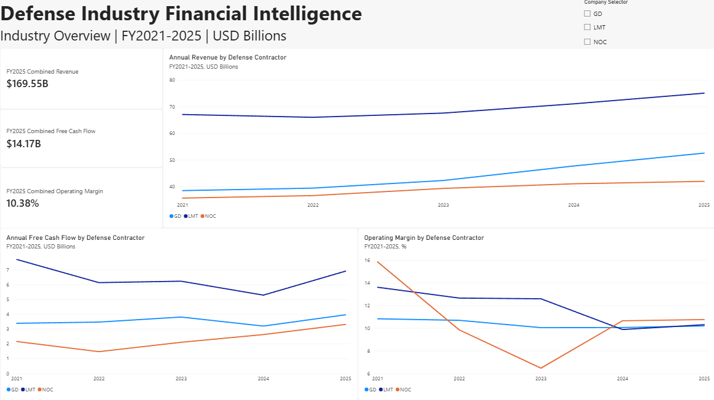
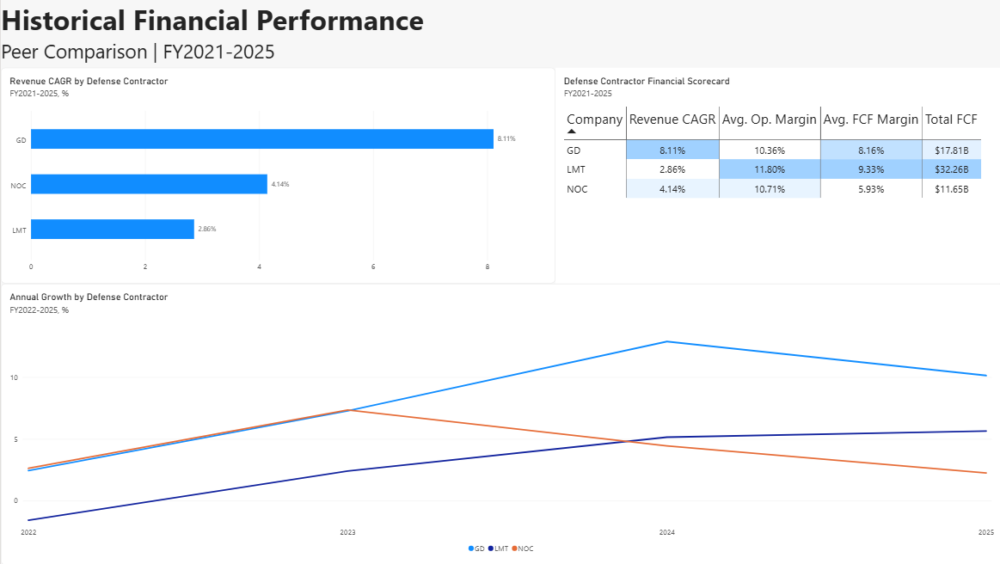
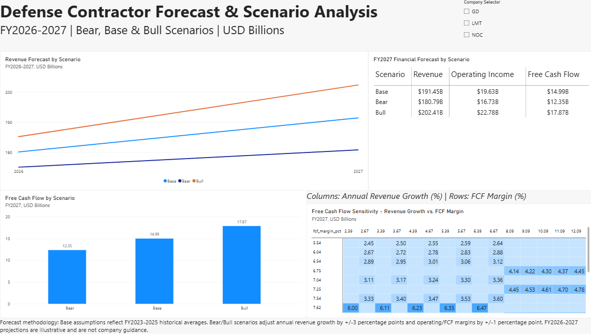

# Defense Industry Financial Intelligence

### Financial Analysis, Peer Benchmarking & Scenario Forecasting | FY2021–2027

An end-to-end financial analytics portfolio project examining the historical performance and projected financial outcomes of three major U.S. defense contractors:

- **Lockheed Martin (LMT)**
- **Northrop Grumman (NOC)**
- **General Dynamics (GD)**

The project integrates SEC EDGAR financial data, Python analysis, SQL, Excel forecasting, and interactive Power BI dashboards to evaluate revenue growth, profitability, free cash flow, and financial performance under alternative forecasting assumptions.

## Project Objectives

- Extract and standardize historical financial information for FY2021–2025.
- Compare revenue growth, operating profitability, and cash flow generation across contractors.
- Analyze financial performance using Python and SQL.
- Develop Bear, Base, and Bull financial projections for FY2026–2027.
- Evaluate forecast sensitivity to revenue growth and free cash flow margin assumptions.
- Communicate findings through interactive Power BI dashboards.

## Technology Stack

| Technology | Application |
|---|---|
| Python | SEC API extraction, data cleaning, financial analysis, forecasting, validation |
| pandas / NumPy | Financial calculations and peer comparisons |
| SQLite / SQL | Financial data storage, analytical views, window functions, peer rankings |
| Microsoft Excel | Formula-driven financial forecasts and sensitivity analysis |
| Power BI / DAX | Interactive dashboards, KPI measures, peer comparisons |
| Google Colab | Python development and analysis environment |

## Historical Financial Findings

**1. General Dynamics led revenue growth.**

General Dynamics achieved an approximately **8.11% revenue CAGR** between FY2021 and FY2025, compared with 4.14% for Northrop Grumman and 2.86% for Lockheed Martin.

**2. Lockheed Martin generated the most cumulative free cash flow.**

Across FY2021–2025, Lockheed Martin generated approximately **$32.26 billion in free cash flow**, compared with $17.81 billion for General Dynamics and $11.65 billion for Northrop Grumman.

**3. General Dynamics demonstrated the most stable operating margins.**

General Dynamics maintained operating margins near 10–11% throughout the historical period, while Lockheed Martin and Northrop Grumman experienced greater margin variability.

**4. FY2025 profitability differed across contractors.**

| Company | Revenue ($B) | Operating Margin | Free Cash Flow ($B) |
|---|---:|---:|---:|
| Lockheed Martin | 75.05 | 10.30% | 6.91 |
| General Dynamics | 52.55 | 10.19% | 3.96 |
| Northrop Grumman | 41.95 | 10.75% | 3.31 |

Northrop Grumman reported the highest operating margin in FY2025, while Lockheed Martin generated the most free cash flow.

## Financial Forecasting: FY2026–2027

The project develops three illustrative forecasting scenarios:

- **Bear:** Historical average revenue growth reduced by 3 percentage points, with operating and free cash flow margins reduced by 1 percentage point.
- **Base:** Revenue growth, operating margin, and free cash flow margin based on FY2023–2025 historical averages.
- **Bull:** Historical average revenue growth increased by 3 percentage points, with operating and free cash flow margins increased by 1 percentage point.

Annual revenue is projected using compounded growth. Operating income and free cash flow are calculated by applying scenario-specific margins to projected revenue.

### FY2027 Revenue Forecasts

| Company | Bear ($B) | Base ($B) | Bull ($B) |
|---|---:|---:|---:|
| Lockheed Martin | 77.15 | 81.79 | 86.56 |
| General Dynamics | 60.27 | 63.69 | 67.21 |
| Northrop Grumman | 43.37 | 45.97 | 48.64 |

### FY2027 Free Cash Flow Forecasts

| Company | Bear ($B) | Base ($B) | Bull ($B) |
|---|---:|---:|---:|
| Lockheed Martin | 5.88 | 7.05 | 8.33 |
| General Dynamics | 4.07 | 4.93 | 5.88 |
| Northrop Grumman | 2.40 | 3.01 | 3.67 |

These projections are illustrative financial scenarios, not company guidance or investment recommendations.

## Sensitivity Analysis

A two-variable sensitivity model evaluates FY2027 free cash flow across alternative revenue growth and free cash flow margin assumptions.

For each contractor, the model tests:

- Five annual revenue growth assumptions.
- Five free cash flow margin assumptions.
- A total of 25 sensitivity combinations per contractor, or 75 combinations overall.

The Excel sensitivity formulas were recalculated and validated against the Python model.

## Interactive Power BI Dashboards

### Industry Overview



Displays historical revenue trends, operating margins, free cash flow, and interactive company-level KPIs.

### Historical Performance



Compares revenue CAGR, operating profitability, cumulative free cash flow, and annual revenue growth.

### Forecast & Scenario Analysis



Visualizes FY2026–2027 Bear/Base/Bull forecasts and FY2027 free cash flow sensitivity, with interactive company selection.

## Project Structure

```text
defense-financial-intelligence/
├── data/
│   ├── defense_peer_financial_ratios.csv
│   ├── defense_peer_scorecard.csv
│   ├── defense_sql_peer_rankings.csv
│   ├── defense_forecast_assumptions.csv
│   ├── defense_scenario_forecast_2026_2027.csv
│   └── defense_fcf_sensitivity_2027.csv
├── notebooks/
│   └── defense_financial_analysis.ipynb
├── sql/
│   ├── defense_financial_intelligence.db
│   └── defense_financial_analysis.sql
├── excel/
│   └── defense_financial_intelligence_forecast_FINAL.xlsx
├── powerbi/
│   └── Defense_Industry_Financial_Intelligence.pbix
├── images/
│   ├── industry_overview.png
│   ├── historical_performance.png
│   └── forecast_scenarios.png
└── README.md
```

## Data Sources and Methodology

Historical financial information was obtained from the **U.S. Securities and Exchange Commission's EDGAR Company Facts API** and standardized into a consistent FY2021–2025 company-year dataset.

Key financial metrics include revenue, operating income, net income, operating cash flow, capital expenditures, total assets, and total liabilities.

Free cash flow is calculated as:

**Free Cash Flow = Operating Cash Flow − Capital Expenditures**

Revenue CAGR is calculated over the four annual intervals between FY2021 and FY2025.

The SQLite database contains standardized financial records and SQL analytical views. SQL window functions are used to calculate annual growth rates and rank peer performance.

The forecast workbook includes historical data, editable assumptions, scenario projections, a scenario summary, sensitivity tables, and an executive summary.

## Validation and Limitations

- All 18 Excel scenario forecast records were validated against Python.
- All 75 Excel sensitivity calculations were validated against Python.
- FY2027 executive summary values were validated against the Python forecast model.
- Reconstructed SQLite analytical views reproduced the expected FY2025 peer rankings.
- The reconstructed SQLite database does not include the original SEC filing-level source-audit table.
- Selected historical figures still require reconciliation to the original company 10-K statements, including the treatment of General Dynamics' derived total liabilities.
- Historical financial results may include nonrecurring items that affect comparisons.
- Forecast assumptions are illustrative and do not represent management guidance or probability-weighted expectations.

## Key Takeaway

The analysis demonstrates that revenue growth, profitability, and cash generation can lead to different assessments of financial performance.

General Dynamics led historical revenue growth and operating margin stability. Lockheed Martin generated the most cumulative free cash flow and maintained the highest average operating and free cash flow margins. Northrop Grumman recorded the highest operating margin in FY2025.

Combining Python, SQL, Excel, and Power BI provides a reproducible analytical framework for comparing defense contractors and exploring alternative financial outcomes.